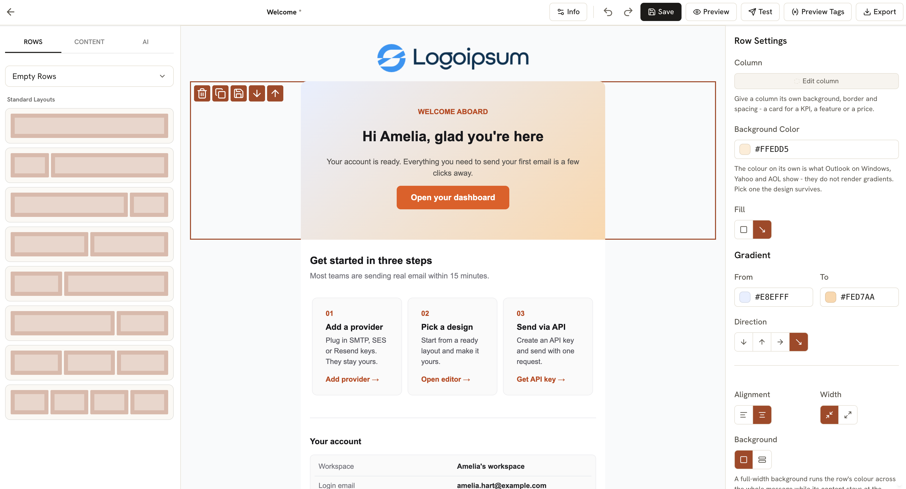
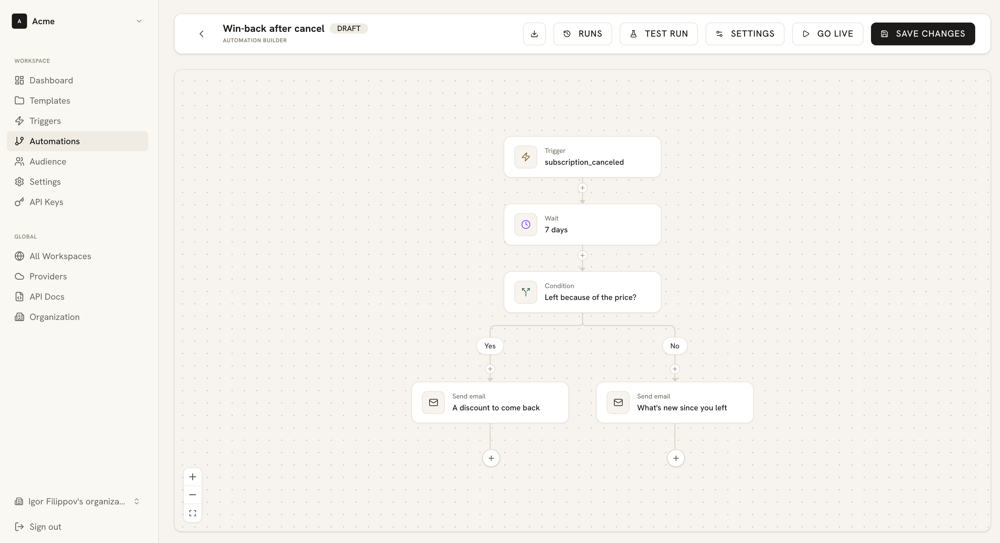
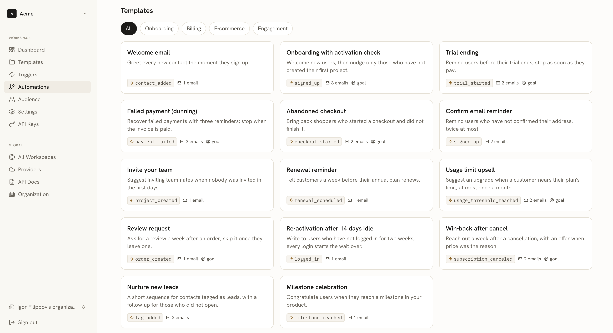

<p align="center">
  <picture>
    <source media="(prefers-color-scheme: dark)" srcset="./assets/senlo-logo-light.svg" />
    
  </picture>
</p>

<h1 align="center">Transactional and lifecycle email infrastructure</h1>

<p align="center">
  Templates, triggers and automations on top of the email provider you already use.<br />
  Resend, Postmark, SendGrid, Mailjet, Amazon SES, Cloudflare Email or any SMTP server. Open source: self-host it or use the hosted version.
</p>

<p align="center">
  <a href="./LICENSE"></a>
  <a href="https://github.com/IgorFilippov3/senlo/actions/workflows/image.yml"></a>
  
</p>

<p align="center">
  <a href="https://senlo.io"><b>senlo.io</b></a> · <a href="https://senlo.io/docs">Docs</a> · <a href="https://senlo.io/register">Get a free account</a>
</p>

<p align="center">
  
</p>

Senlo is an open-source, developer-first email infrastructure designed to handle the entire lifecycle of your product's emails. It provides the tools to build, manage, and deliver transactional and lifecycle emails without being locked into a specific delivery provider.

## Quick Start

Run a full Senlo instance locally. Docker is the only requirement.

```bash
git clone https://github.com/IgorFilippov3/senlo.git
cd senlo/deploy/vps
cp env.example .env
sed -i.bak "s|YOUR_AUTH_SECRET_HERE|$(openssl rand -base64 32)|" .env && rm .env.bak
docker compose up -d
```

Docker pulls the published image (about a minute). When it is up, open **http://localhost:3000** and create an account — you land in an example project with four ready-made templates you can open in the visual editor right away.

To start sending, add your email provider credentials (Resend, Postmark, SendGrid, Mailjet, Amazon SES, Cloudflare Email, or any SMTP server) on the **Providers** page. The interactive API reference lives at **`/api-docs`** on your own instance.

For a production setup on a server, see the [VPS Deployment Guide](./deploy/vps/README.md).

## Why Senlo?

Most email platforms are built for marketing teams, bundling editing, sending, and analytics into closed ecosystems. Senlo is built for **developers and product teams** who need:

- **Full Control**: Self-host your email infrastructure and keep your data on your own servers.
- **Provider Agnostic**: Send through Resend, Postmark, SendGrid, Mailjet, Amazon SES, Cloudflare Email, or any SMTP server — including Mailgun or a mail server you run yourself — without changing your code.
- **Visual & Code**: A powerful drag-and-drop builder for designers, with a clean API for developers.
- **Lifecycle Management**: Manage everything from password resets to complex automated onboarding sequences.

## Key Capabilities

- **Visual Drag-and-Drop Editor**: Build beautiful, responsive templates without writing HTML/MJML.
- **API-First Approach**: Trigger emails, manage contacts, and track events via a robust REST API.
- **Dynamic Personalization**: Use merge tags and conditional logic to tailor content for every recipient.
- **Template Versioning**: Track changes and roll back to previous versions of your email designs.
- **Multi-Project Isolation**: Manage multiple products or environments (Staging/Production) from a single instance.

## Automations that branch on your own data

Drag out a journey on the canvas: send an email, wait, then ask **your** API whether the user did the thing, and take a different path depending on the answer. Every node shows how many people are sitting in it right now and how many have moved on.

<p align="center">
  
</p>

You do not have to start from an empty canvas: there are ready-made automations for onboarding, billing, e-commerce and engagement, each with its trigger, emails and goal already wired.

<p align="center">
  
</p>

## Delivery you can actually see

Sends, deliveries, bounces and engagement for every project, plus a live feed of what went wrong and who was suppressed before a bad address could damage your sending reputation.

## An API, not a black box

Two endpoints do the work: `POST /api/triggered` sends one transactional email from a template, and `POST /api/events` feeds contact events into your automations. Every instance serves its own interactive reference at `/api-docs`.

## Use Cases

- **Transactional Emails**: Reliable delivery for password resets, receipts, and verification codes.
- **Product Lifecycle**: Automated onboarding series, feature announcements, and re-engagement campaigns.
- **Embedded Editor**: Integrate the visual builder directly into your own SaaS product.

## Status

Senlo is currently in active development (MVP stage). We are stabilizing the API and adding core features. Contributions and feedback are welcome!

Check out our [Roadmap](ROADMAP.md) for planned features and upcoming improvements.

## Author

**Igor Filippov**

- GitHub: [@IgorFilippov3](https://github.com/IgorFilippov3)
